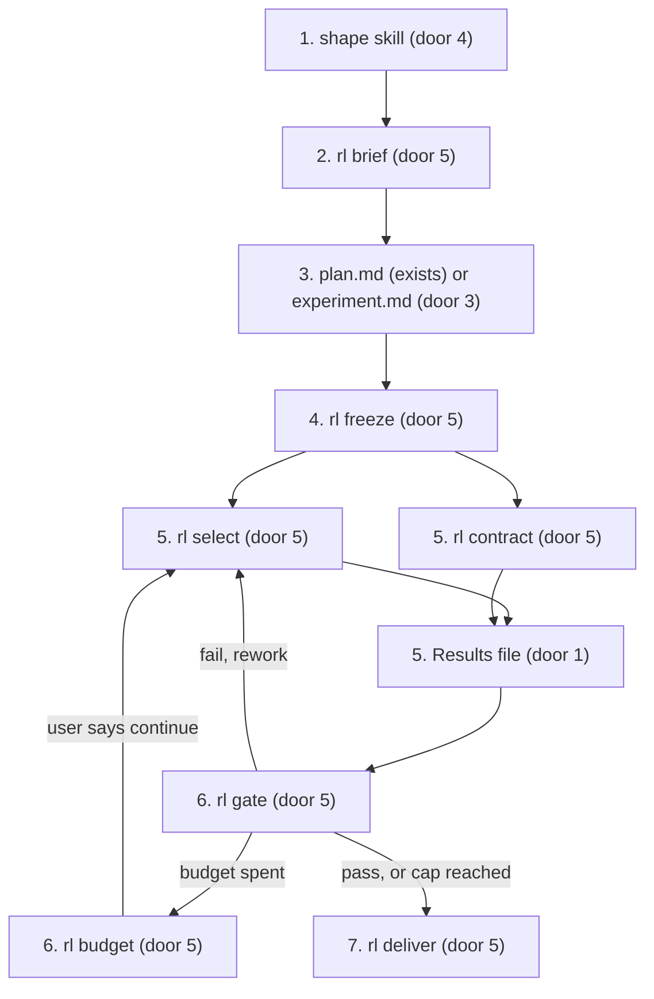
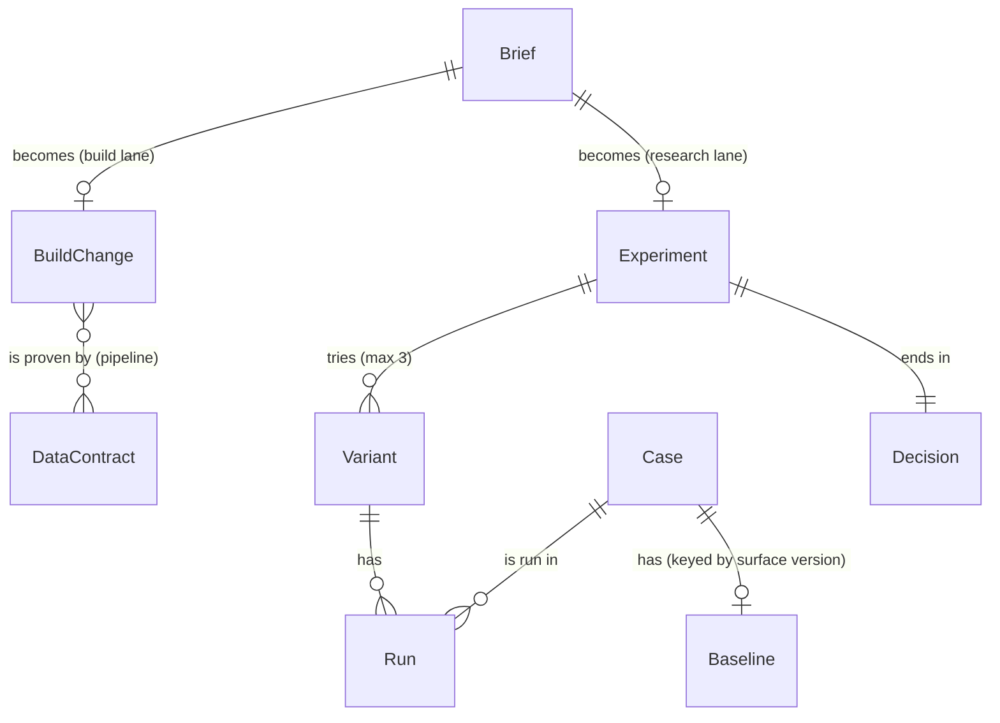
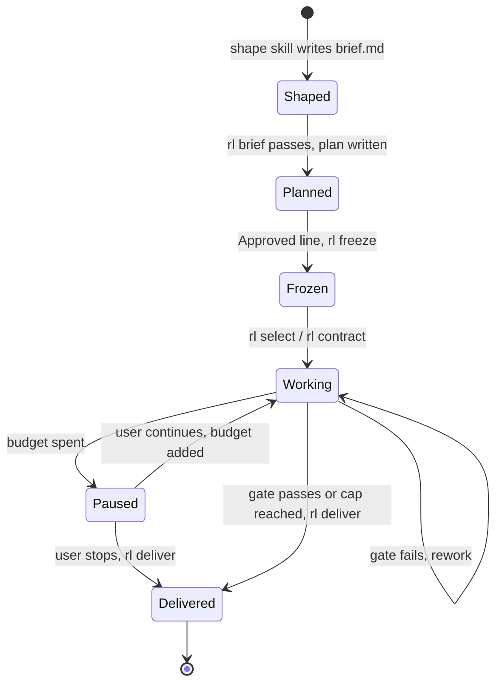

# MVP lanes

**Approved**: 2026-11-21 - user: "Approved, go ahead"

## Problem

The engineer builds four kinds of things - apps, data pipelines (on Databricks), ML models and
agents (deepagents, outside Databricks) - and drives them with several coding agents (Claude Code,
GitHub Copilot, Databricks Genie). Spec-driven work (tlc-spec-lean) is fast for code a test can
prove, but:

- changing an agent's or a model's behavior to fit a dataset goes through a loop whose proof is a
  passing test, which behavior does not have: a change fixes the cases someone read and silently
  breaks others; evidence from the MINDS agent (40 real questions, MLflow traces): a variant
  raised recall while adding ~100k input tokens per turn and nothing stopped it; the agent reads
  history records and then does not cite them, and the recall metric cannot tell a retrieval
  failure from a synthesis failure; a fix may touch far more files than the problem needs; a full
  rerun costs ~480 agent runs, so it is skipped;
- a pipeline change has no written promise about its output data, so a reader finds a broken
  column after the fact;
- ideas arrive as meeting transcripts, research and notes; they reach planning unstructured, and
  what is not ready is found during the build.

When this ships, every piece of work goes shape → goal → plan → approve → work → verify → deliver.
Shape turns offline material into a Brief that says what is ready and what is not. The lane is
chosen by what can prove the work. Verification is a script any agent can run: a data contract
compiled to SQL for pipelines, a per-Case gate against a Baseline for agents and models, the
host's e2e results for apps. The agent keeps working until the gate closes the goal, and stops to
ask when the token budget runs out.

## Shape

Reuses tlc-spec-lean for build-lane planning and checks, the host's own runners (pytest,
Playwright, the MINDS MLflow eval, Databricks jobs) for running work, and the host's engine for
SQL; the harness runs none of them. Every rule that changes an outcome - brief readiness, lane
selection of Cases, contract compilation, pass/fail, guardrail budgets, Edit Scope, budget stop -
runs in the `lanes` Python package, which its pytest suite reaches; the skills only say when to
call it.

1. engineer drops transcripts, research and notes in `.lanes/inbox/<slug>/` -> `shape skill`
   (door 4) - reads them and the repo, grills in short rounds, writes `brief.md` (door 3) with the
   goal, Profile, lane and a Readiness row per item, and a Results-file glue script in the host
   when the Profile needs one
2. `rl brief` (door 5) - refuses a Brief with no goal, no Profile, no lane, or a `not ready` row
3. plan: build lane -> tlc-spec-lean `plan.md` (exists), which for the `pipeline` Profile cites
   `contracts/<dataset>.yaml` (door 6), its input fixture and golden rows; research lane ->
   `experiment.md` + `experiment.json` (door 3) with the Failure Mode, Target Metric, Guardrails,
   Edit Scope, Target Cases and token budget
4. approve: the human writes the `**Approved**:` line; `rl freeze` (door 5) validates and records
   the start commit
5. work, by the agent with the host's tools: `rl select` (door 5) writes `selection.json`;
   `rl contract` (door 5) compiles a contract into `contract.sql`; the agent runs the selected
   Cases, the pipeline or the e2e suite and writes Results files (door 1)
6. verify: `rl gate` (door 5) judges the Results files, the Baseline and the git diff since
   freeze; on fail the agent reworks and returns to 5 until the gate passes, the variant cap is
   reached, or `rl budget` (door 5) reports the budget spent and the agent asks the user
7. deliver: `rl deliver` (door 5) writes `delivery.md` - the gate evidence, and for an Experiment
   its Decision (adopt / promote / reject); `promote` also writes the brief of a Build Change

**Changes underneath**

| Front | What changes |
| --- | --- |
| domain | new terms in `GLOSSARY.md`: Shape, Brief, Readiness, Delivery, Lane, Profile, Build Change, Experiment, Diagnosis, Failure Mode, Edit Scope, Variant, Decision, Case, Target Metric, Guardrail, Baseline, Target/Affected/Stable Cases, Cited/Read recall, Results file, Data contract |
| stored data | nothing to migrate - new files only, in the host repo under `.lanes/` and `contracts/` |
| readers | the engineer reads `brief.md`, `results.md`, `delivery.md`; tlc-spec-lean cites `rl gate` as a proof command; a Databricks notebook or Genie runs `contract.sql` |

New: Brief, Experiment, Variant, Run, Baseline, Decision, Delivery as files in the host repo;
Data contract as a YAML file per dataset. One-way constraints: Results file shape (door 1),
config shape (door 2), folder layout (door 3), contract subset (door 6).

## Surface

None - no network route; the CLI's commands, flags and exit codes are a consumed contract and are
door 5.

## Landing

| One-way door | Literal shape | Alternative rejected |
| --- | --- | --- |
| 1. Results file | `.lanes/work/<slug>/runs/<name>.json`: `{"runs":[{"case":"q01","run":1,"metrics":{"cited_recall":1.0,"read_recall":1.0,"input_tokens":52000},"touched":["skill:history"],"trace":"<id or url>"}]}`; a CSV file with a `case` column and one column per metric (the saved output of `contract.sql`) is read as one run per row; a JUnit XML file is read as one run per test case with metric `passed` | an Adapter command the harness calls - Databricks jobs and Genie cannot be launched that way, and the host already has runners |
| 2. Host config | `lanes.json` at the host root: `profiles.<app\|pipeline\|model\|agent>.{lane, metrics, surface, default_edit_scope, k}`, `metrics.<name>.{pass_at \| budget_pct}`, `surface.<item>.{paths, affects_all}`, `max_variants`, `budget_tokens` | YAML for config - config is read on every command; JSON keeps the CLI importable without a dependency when no contract is used |
| 3. Work folder | `.lanes/inbox/<slug>/` (offline material), `.lanes/work/<slug>/` with `brief.md`, `experiment.md`, `experiment.json`, `frozen.json`, `selection.json`, `contract.sql`, `runs/`, `results.md`, `budget.md`, `delivery.md`; Baselines in `.lanes/baseline/<profile>/<case>.json` | MLflow or the board as the only record - they keep runs or status, not the why, the scope or the decision, and every agent and Databricks reads files from git |
| 4. Instructions | `skills/shape/SKILL.md`, `skills/lanes/SKILL.md` in the Agent Skills format, plus an `AGENTS.md` snippet that points to them | a Claude Code plugin with hooks and sub-agents - GitHub Copilot and Databricks Genie cannot run them |
| 5. CLI and exit codes | `python -m lanes <brief\|freeze\|baseline\|select\|contract\|gate\|budget\|deliver> <slug>` (alias `rl`); exit `0` ok/pass, `1` gate fail, `2` invalid or missing input, `3` variant cap reached, `4` budget spent - ask the user | one exit code for every failure - an agent or a Build Change citing `rl gate` could not tell a regression from a broken setup or a budget stop |
| 6. Data contract subset | ODCS v3 YAML: `schema[].properties[]` with `name`, `logicalType`, `required`, `unique`, `quality[]`; `quality` rules `rowCount` (`mustBeBetween`), `nullValues`, `invalidValues` (`validValues`), `duplicateValues`, `freshness` (`column`, `maxAgeHours`), `sql` (a query returning a violation count); dependency `pyyaml` | an own JSON format - not a standard, so the contract could not be shared with catalog or quality tools later |

- Nothing else in this change is hard to reverse

## Criteria

### S1: Shape ends in a Brief that says what is not ready (P1)

The engineer's offline material and a short grilling end in a Brief the CLI can refuse.

**Acceptance Criteria**

1. IF `brief.md` has no `## Goal` text, no Profile among `app`, `pipeline`, `model`, `agent`, or no lane among `build`, `research` THEN `rl brief` SHALL exit `2` naming each missing field
2. IF a `## Readiness` row is `not ready` THEN `rl brief` SHALL exit `2` naming the item; a `needs attention` row SHALL be printed as a warning with exit `0`
   - all `ready` → `0`; one `needs attention` → `0` plus the warning; one `not ready` → `2`
3. IF the lane is `research` and the Brief names no metric that `lanes.json` declares for its Profile THEN `rl brief` SHALL exit `2`

### S2: A pipeline is proven by its data contract (P1)

A contract compiles to SQL any engine runs; each rule is a Case with its violation count.

**Acceptance Criteria**

4. WHEN `rl contract <slug>` runs on a dataset's contract THEN it SHALL write `contract.sql` as one query returning one row `(case, violations)` per rule, with case ids `<dataset>.<column>.<rule>` or `<dataset>.<rule>`
   - `required: true` on `order_id` → case `orders.order_id.required`; `unique: true` → `orders.order_id.unique`; a table-level `rowCount` → `orders.rowCount`
5. WHEN the compiled SQL runs on SQLite against the example fixture THEN each rule's `violations` SHALL equal the number of rows breaking it
   - 2 null `order_id` → `2`; `rowCount mustBeBetween [1, 100]` with 0 rows → `1`; with 50 rows → `0`; `freshness maxAgeHours 24` with the newest row 25 hours old → `1`
6. IF the contract uses a rule outside door 6's subset THEN `rl contract` SHALL exit `2` naming the rule and write no `contract.sql`
7. WHEN `rl gate` judges a build-lane pipeline THEN it SHALL exit `1` naming every contract Case with violations above `0` and every golden row missing from the output

### S3: A behavior change is judged per Case against a Baseline (P1)

For an agent or a model, only the selected Cases run, and the gate names every regression.

**Acceptance Criteria**

8. WHEN `rl select` runs THEN it SHALL put the Experiment's listed Cases in Target with `k.target` runs, Cases whose Baseline `touched` maps to a path inside the Edit Scope in Affected with `k.affected`, and every other Case in Stable with `0` runs
   - Edit Scope `prompts/history.md`, q07 touched `skill:history` mapped to it → Affected; q09 touched only `tool:resolve_equipment` → Stable; a Case both listed and touched → Target, once
9. WHEN the Edit Scope contains a path of a surface item with `affects_all: true` THEN `rl select` SHALL put every non-Target Case in Affected
10. WHEN a Case's Baseline was recorded under a different content hash of the paths its `touched` items map to THEN `rl select` SHALL list it as stale for a Baseline rerun
11. WHEN `rl gate` classifies a Case THEN it SHALL count a run as passed only if every metric with `pass_at` meets it, and the Case as passed only if a majority of its runs passed
    - 2 of 3 → passed; 1 of 3 → failed; 1 of 1 → passed; 1 of 2 → failed
12. WHEN `rl gate` runs THEN it SHALL exit `1` naming the Case if a Case that passed its Baseline fails in the variant
13. WHEN `rl gate` runs THEN it SHALL exit `1` naming the Case and metric if a Case's mean of a `budget_pct` metric exceeds its Baseline mean by more than that percentage
    - Baseline 50,000 input tokens, budget 15 → 57,500 passes, 57,501 fails; +100k fails
14. WHEN `rl gate` runs on an Experiment THEN it SHALL exit `1` unless the Target Metric's mean over Target Cases improved on the Baseline mean by at least `min_delta`
15. IF a Case in `selection.json` has fewer runs in the Results files than its k THEN `rl gate` SHALL exit `1` naming the Case and the runs missing
16. WHEN `rl gate --confirm` runs THEN it SHALL require at least one run for every Stable Case
17. WHEN `rl gate` exits THEN `results.md` SHALL hold one row per judged Case with Baseline status, variant status, Target Metric before/after and each Guardrail before/after
18. WHEN `rl gate --regression-only` runs THEN it SHALL apply criteria 12, 13, 15 and 19 and skip 14, so a Build Change can cite it as an end-to-end proof

### S4: Edit Scope enforced by the diff (P1)

A change outside the approved paths cannot pass, whichever agent made it.

**Acceptance Criteria**

19. IF `git diff <frozen start commit>` lists a changed or untracked path outside the Edit Scope, `.lanes/work/<slug>/` and `.lanes/baseline/` THEN `rl gate` SHALL exit `1` listing each path
    - `prompts/history.md` inside scope → no finding; `tools/sql.py` → finding; a new untracked file outside scope → finding
20. WHERE `experiment.json` has no `edit_scope` the system SHALL use the Profile's `default_edit_scope`

### S5: The budget stops the loop and the user decides (P2)

The agent stops when the budget is spent and continues only on the user's word.

**Acceptance Criteria**

21. IF the summed `input_tokens` of all Results files in the work reach `budget_tokens` THEN `rl budget <slug>` and `rl select <slug>` SHALL exit `4` printing the spend and the instruction to ask the user
22. WHEN `rl budget <slug> --add <tokens> --user "<their words>"` runs THEN it SHALL raise the budget by that amount and append the amount, date and quote to `budget.md`
23. IF `rl budget --add` is given no `--user` text THEN it SHALL exit `2` and leave the budget unchanged
24. IF the Experiment already has `max_variants` variants with runs THEN `rl select --variant <new name>` SHALL exit `3`

### S6: Delivery closes the goal (P2)

The work ends in one document with its evidence, and a promote hands the build lane a Brief.

**Acceptance Criteria**

25. IF the last `rl gate` did not exit `0` and the work is not an Experiment ending in `reject` THEN `rl deliver` SHALL exit `2`
26. WHEN `rl deliver <slug>` runs THEN `delivery.md` SHALL hold the goal from the Brief, the last gate command and its verdict table, and the commits since freeze
27. WHEN `rl deliver <slug> --decision promote` runs THEN it SHALL write `.lanes/work/<slug>-build/brief.md` with lane `build`, the Failure Mode, the Target Cases and the gate command the Build Change cites as proof

### S7: Apps reuse their own e2e suite (P2)

An app's existing e2e results decide its gate, with no new test format.

**Acceptance Criteria**

28. WHEN `rl gate` judges a build-lane app whose Results file is JUnit XML THEN it SHALL exit `1` naming each failed or errored test, and `0` when all passed and at least one ran

### S8: Every Profile end to end on local engines (P1)

One worked example per Profile runs the seven stages on a laptop.

**Acceptance Criteria**

29. WHEN `examples/run_all.sh` runs THEN each of `examples/app`, `examples/pipeline`, `examples/model`, `examples/agent` SHALL go from a `brief.md` through `rl brief`, `rl freeze`, its work and `rl gate` to `rl deliver` with exit `0`, using SQLite for the pipeline, a stdlib model, a scripted fake agent and a stdlib e2e suite
30. WHEN the `agent` example's seeded regression variant runs THEN `rl gate` SHALL exit `1` naming the regressed Case and the input-token Guardrail it broke

## Out of scope

| Excluded | Why |
| --- | --- |
| Creating or relabelling GitHub issues (`lane:build` / `lane:research`) | the lane rule lives in the Brief first; automating the board is its own change |
| Real host glue (MINDS MLflow export, a Databricks pipeline job) | each is a Build Change in its own repo; the shape skill writes it when a real host adopts `lanes` |
| Contract checks on production data as monitoring | AD-007 proves a change on a fixture; monitoring is a separate concern |
| Writing new Cases into a host dataset (MLflow, holdout) | the dataset is the host's; `delivery.md` lists Case ids to add |
| Agent-specific hooks | the diff check enforces the Edit Scope for every agent (AD-002) |
| Statistical significance tests | with k ≤ 3 a majority rule and `min_delta` are honest; a test would claim precision the data lacks |

## Assumptions

| Assumption | Chosen default | Rationale | Confirmed? |
| --- | --- | --- | --- |
| Lane rule | build if an end-to-end test reproducing the user's behavior proves it; research if only a rate over a dataset can | AD-001 | y |
| Agents it must run under | Claude Code, GitHub Copilot, Databricks Genie | AD-002 | y |
| Profiles | `app`, `pipeline`, `model`, `agent` | AD-004 | y |
| Variant cap | 3 | asked Q5; user: "ok" | y |
| k defaults | target 3, affected 1, stable 1 in the confirm run; for a model, k is seeds | asked Q17, Q25; user: "ok", "yes" | y |
| Default guardrail budgets | input tokens 15%, latency 20% | asked Q8; user: "agree" - real values are set per host | y |
| Budget exhausted | stop and ask; continue only with the user's words recorded | AD-012 | y |
| Brief readiness levels | `ready`, `needs attention`, `not ready`; only `not ready` blocks | user: "clarify what is not ready, what needs more attention"; blocking only on `not ready` is the builder's default | n |
| Runtime | Python 3.9+ plus `pyyaml`; `python -m lanes` | Databricks runtimes ship both; laptops need one install | n |
| Genie loads the skills | Claude Code and Copilot load the Agent Skills format; for Genie the `AGENTS.md` snippet is pasted into its workspace instructions | not verified for Genie | n |
| Case pass rule | every metric with `pass_at` meets it in that run; the majority of runs decides | follows from the per-Case gate (Q9) | n |

**Open questions:** none - all resolved or logged above.

## Differences from the source

None - the product matches the source

## Sources

- Conversation 2026-11-21, grilling Q1-Q28 and the seven-stage flow - binding - lanes, Profiles, stages, gates, selection, contracts, budget, Results file
- `Skills_for_Real_Engineers_Matt_Pocock_Playbook_v3.pdf` - non-binding - user: "dont bias towards them" - grill before spec, feedback loops, prototype then delete
- `Fabrica-de-Software-Agentica-TLC.pdf` - non-binding - verification contract written first, rules in code over prompts
- idealo, "AI assisted Research with OpenSpec" (Medium, 2026-11-05) - non-binding - evaluation plan before tasks, results with decision and follow-ups
- Oracle Open Agent Specification 26.3.1 - non-binding - declaration separate from runtime; Dataset / Metric / Evaluator
- Open Data Contract Standard v3 - non-binding - the contract subset in door 6
