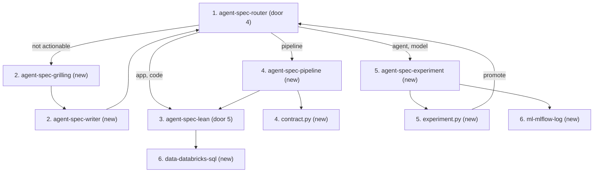
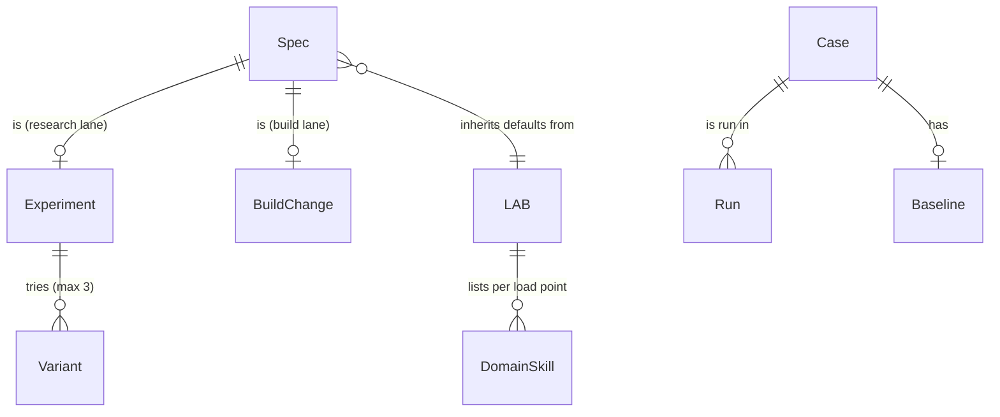

# v2: agent-spec skills

**Approved**: 2026-11-22 - user: "Approved, go ahead"

## Problem

The MVP works, but the engineer would have to operate it by hand. They fill a `lanes.json` once per project,
install a package, run `rl` commands, and keep work in a second tree (`.lanes/`) beside `.specs/`. The skills
have no clear "when to use". The engineer's words: "lanes.json is horrible. I'll not fill any json", "I'll not
run any rl XXXX. It's the agent that does", "I do nothing, I just fill talking to agent if need or by building
context in the beginning (spec, design doc, problem, etc)". Domain know-how (how to query the data, avoiding
leakage, logging to MLflow) has no place in the loop either.

When this ships, the engineer gives the agent a spec or just context. `agent-spec-router` always runs first:
it grills or drafts a spec when the context is not yet actionable, then routes the work to
`agent-spec-lean` (app and code), `agent-spec-pipeline` (data, with a data contract in the spec) or
`agent-spec-experiment` (agent or model behavior, judged per Case). The agent runs every script. All settings
live in the spec, with defaults; what is the same across work is learned once into `.specs/LAB.md`. Domain
skills load at fixed points of each loop.

## Shape

Reuses the MVP's rules (Results file, contract compiler, per-Case gate, Edit Scope diff, budget, decisions)
and tlc-spec-lean whole, renamed. Every rule that changes an outcome runs in the stdlib scripts under each
skill's `scripts/`, which the repo's pytest suite reaches; the `SKILL.md` files only say when to run them.

1. engineer gives a spec or context -> `agent-spec-router` (new, door 4) - reads it, `.specs/LAB.md` and the
   repo; when the context is not actionable it calls `agent-spec-grilling` (new) and `agent-spec-writer`
   (new); when actionable it picks the Profile and the lane and hands over; it also takes back a `promote`
2. `agent-spec-writer` (new) - drafts `.specs/features/<slug>/spec.md` (door 3) from the lane's template
   (door 2); `agent-spec-grilling` (new) asks only for what is missing
3. `agent-spec-lean` (door 5) - tlc-spec-lean renamed: plan, checks, build, verify for app and code
4. `agent-spec-pipeline` (new) - adds the data contract section, `contract.py` (new) compiles it to SQL,
   and hands plan, checks and verify to `agent-spec-lean` with the contract gate as a proof
5. `agent-spec-experiment` (new) - `experiment.py` (new) validates and freezes the spec, records the
   Baseline, selects Cases, gates each variant, checks the budget and delivers the Decision
6. at plan, work and verify each lane loads the domain skills `.specs/LAB.md` lists for that point, such as
   `data-databricks-sql` (new) and `ml-mlflow-log` (new)
7. out: `delivery.md` in the work folder; a `promote` goes back to `agent-spec-router`

**Changes underneath**

| Front | What changes |
| --- | --- |
| domain | `Shape` and `Brief` leave the glossary; `Spec` (the one document per piece of work), `LAB.md`, `Domain skill`, `Load point`, `Capability Case`, `Regression Case` enter; `Adapter` stays gone |
| stored data | nothing to migrate: no host uses the MVP yet; `.lanes/` and `lanes.json` stop being read |
| readers | the four examples move to `spec.md` and `.specs/`; the README and `docs/workflow.md` describe the new skills |

New: `spec.md` per piece of work and `.specs/LAB.md` per project, both markdown. Removed: `lanes.json`,
`brief.md`, `experiment.json`, `.lanes/`.

## Surface

None - no network route; the scripts' commands and exit codes are door 6.

## Landing

| One-way door | Literal shape | Alternative rejected |
| --- | --- | --- |
| 1. Results file | unchanged from the MVP: `runs/<variant>/*.json` `{"runs":[{"case","run","metrics","touched","trace"}]}`, a CSV with a `case` column, or JUnit XML | a new format - every glue script written for the MVP shape would break |
| 2. Lane templates | `agent-spec-experiment/references/spec-agent.md`, `spec-model.md`; `agent-spec-pipeline/references/spec-pipeline.md`; `agent-spec-lean`'s own plan template | one template for every lane - an agent spec is a set of questions, a pipeline spec is a contract |
| 3. Work folder | `.specs/features/<slug>/spec.md`, `runs/<variant>/`, `selection.json`, `frozen.json`, `contract.sql`, `results.md`, `budget.md`, `delivery.md`; Baselines in `.specs/baseline/<profile>/<case>.json`; project facts in `.specs/LAB.md` | `.lanes/work/` - a second tree beside tlc-spec-lean's `.specs/` |
| 4. Router as the entry | `agent-spec-router/SKILL.md` whose description starts "Use first for any work..." and is the only skill that routes between lanes | each lane skill deciding for itself - two lanes could claim the same work and a `promote` has no owner |
| 5. `agent-spec-lean` | tlc-spec-lean 3.x copied whole under the new name, its references and scripts renamed, plus the load points | a dependency on the installed tlc-spec-lean - Copilot and Genie do not have it, and the name would stay `tlc` |
| 6. Script commands and exit codes | `python3 <skill-dir>/scripts/experiment.py <freeze\|baseline\|select\|gate\|budget\|deliver> <slug>`, `python3 <skill-dir>/scripts/contract.py <compile\|gate> <slug>`; exit `0` ok, `1` gate fail, `2` invalid input, `3` variant cap, `4` budget spent - ask the user | an installed `rl` CLI - the engineer does not run commands, and a pip install is a step the agent cannot always take on Databricks |
| 7. Spec sections the scripts read | `**Profile**:`, `**Lane**:`, `**Approved**:` lines; tables under `## Cases`, `## Metrics`, `## Surface`, `## Data contract`, `## Golden rows`; lists under `## Edit Scope`; optional `**Budget**:`, `**Variants**:`, `**Dataset**:` lines; `.specs/LAB.md` holds the same `## Metrics` and `## Surface` tables as project defaults | JSON beside the spec - the engineer said they will not fill JSON, and two files drift |

| 8. Plugin packaging | the repo root is the plugin: `skills/<name>/SKILL.md`, `plugin.json` with `"$schema": "https://agent-plugins.org/schemas/1.0.0/plugin.schema.json"` and `"name": "agent-spec"` (VS Code, Copilot), `.claude-plugin/plugin.json` and `.claude-plugin/marketplace.json` listing `agent-spec` with `"source": "./"` (Claude Code); Databricks clones the repo as a Git folder | a copy of `skills/` per tool - three copies drift, and Databricks can only start from a cloned repo |
| 9. Router bookkeeping script | `agent-spec-router/scripts/route.py <freeze\|junit\|deliver> <slug>`; build work writes `gate.json` (from `route.py junit` or `contract.py gate`) before `route.py deliver` | delivery inside agent-spec-lean - it owns verification, not the hand-off record every lane shares |

- Nothing else in this change is hard to reverse

## Criteria

### S1: The router is the one entry (P1)

Any context goes to the router, which grills when it must and routes the rest.

**Acceptance Criteria**

1. The `agent-spec-router` description SHALL start with "Use first" and name the three lanes it routes to, and its body SHALL route by the proof: an end-to-end test → `agent-spec-lean` or `agent-spec-pipeline`, a rate over a dataset → `agent-spec-experiment`
2. WHEN the context names no goal or no way to prove it THEN `agent-spec-router` SHALL call `agent-spec-grilling` before routing
3. WHEN a delivery holds a `promote` Decision THEN `agent-spec-router` SHALL route its brief to the build lane
4. WHEN `agent-spec-router` meets a project with no `.specs/LAB.md` THEN it SHALL write one with the eval command, the results glue, the metrics, the surface map and the domain skills per load point, each confirmed with the user

### S2: A spec from context, with defaults (P1)

The engineer never fills a config; the spec holds what is needed and defaults cover the rest.

**Acceptance Criteria**

5. WHEN `experiment.py freeze` reads a `spec.md` with no `## Metrics` table THEN it SHALL use the table in `.specs/LAB.md`, and a spec row SHALL override the LAB row of the same metric
6. WHEN a spec omits `**Variants**:`, the k values or a guardrail budget THEN `experiment.py` SHALL use 3 variants, k target 3 / affected 1 / stable 1, and `input_tokens` +15% and `latency_ms` +20% for whichever of those metrics exist
7. IF a research spec has no `**Approved**:` line, no Case, or a Target Metric absent from the merged metrics THEN `experiment.py freeze` SHALL exit `2` naming what is missing
8. WHEN an agent-behavior `## Cases` table has only `Case`, `Question` and `Rubric` columns THEN `experiment.py` SHALL accept it; `Read`, `Cite`, `Route`, `Failure mode` and `Tier` columns SHALL be optional and used only when present
   - only question + rubric → accepted; plus `Cite` → cited recall graded on that Case; a row with an empty `Cite` → not graded on it
9. IF a spec has neither a `## Cases` table nor a `**Dataset**:` line THEN `experiment.py freeze` SHALL exit `2`

### S3: The experiment gate, capability and regression (P1)

The MVP's per-Case gate, read from markdown, with pass^k for regression Cases.

**Acceptance Criteria**

10. WHEN `experiment.py gate` judges a Case marked `regression` THEN it SHALL fail the Case unless every one of its runs passes
    - 3 of 3 → passed; 2 of 3 → failed
11. WHEN `experiment.py gate` judges a `capability` Case, or a Case with no tier THEN it SHALL pass it on a majority of runs
    - 2 of 3 → passed; 1 of 2 → failed
12. The gate SHALL keep every MVP rule: regression named per Case, guardrail budget per Case, Target `min_delta`, missing runs, `--confirm`, `--regression-only`, and the Edit Scope diff with renames and spaces
13. WHEN `experiment.py deliver --decision adopt` runs THEN it SHALL add one to the passing streak of each capability Case that passed, reset it for one that failed, and list in `delivery.md` every Case whose streak reached 3 as proposed for regression
14. WHEN `experiment.py select` or `budget` finds the budget spent THEN it SHALL exit `4` printing the instruction to ask the user, and `budget --add <n> --user "<words>"` SHALL record the words in `budget.md`

### S4: A pipeline proven by the contract in its spec (P1)

**Acceptance Criteria**

15. WHEN `contract.py compile` reads a `## Data contract` section THEN it SHALL compile each `### <dataset>` columns table (`Column`, `Type`, `Required`, `Unique`, `Accepted values`) and its `Rules:` list (`rowCount between <a> and <b>`, `freshness <column> <hours>h`, `sql <name>: <query>`) into one SQL query returning `(case, violations)`
    - `Required: yes` on `order_id` → case `orders.order_id.required`; `Accepted values: open, closed` → `orders.status.invalidValues`
16. WHEN the spec has a `## Golden rows` table THEN `contract.py compile` SHALL add one Case per row, `0` when present and `1` when absent, comparing values as text
17. WHEN the spec has no `## Data contract` section and the project has an ODCS contract file under `contracts/` THEN `contract.py compile` SHALL read the ODCS file; IF `pyyaml` is not importable THEN it SHALL exit `2` saying so
18. WHEN `contract.py gate` runs THEN it SHALL exit `1` naming every contract Case above `0` and every missing golden row, and `0` when all are `0`

### S5: Domain skills at fixed load points (P2)

**Acceptance Criteria**

19. The skills `agent-spec-lean`, `agent-spec-pipeline` and `agent-spec-experiment` SHALL each name three load points - plan, work, verify - and SHALL load there the domain skills `.specs/LAB.md` lists for that point
20. The repo SHALL ship `data-databricks-sql` and `ml-mlflow-log` as example domain skills, each with a description that starts "Use when" and names its load point

### S6: Skills described and every example on the new shape (P1)

**Acceptance Criteria**

21. Every skill under `skills/` SHALL have frontmatter `name` equal to its folder and a `description` that contains "Use when" or "Use first"
22. WHEN `examples/run_all.sh` runs THEN `app`, `pipeline`, `model` and `agent` SHALL each go from a `spec.md` in `.specs/features/<slug>/` to `delivery.md` with exit `0`, with no `lanes.json` and no `rl` command
23. WHEN the agent example's "read in full" variant runs THEN the gate SHALL exit `1` naming `q02` as regressed and its `input_tokens` guardrail
24. WHEN `agent-spec-lean`'s `selftest.py` runs after the rename THEN it SHALL exit `0`

### S7: Installable from anywhere (P1)

The team installs it from GitHub in Claude Code, VS Code and Copilot, or clones it into Databricks.

**Acceptance Criteria**

25. The repo SHALL carry `plugin.json` (Agent Plugins 1.0 `$schema`, `name` `agent-spec`, a semantic `version`), `.claude-plugin/plugin.json` with the same name and version, and `.claude-plugin/marketplace.json` listing `agent-spec` with source `./`; every skill folder name SHALL be kebab-case with a `SKILL.md`

## Out of scope

| Excluded | Why |
| --- | --- |
| Wiring a real host (memhub-lite, MINDS) | waits for memhub-lite F3; a separate change in the host repo |
| A model grader for rubric points | the rubric column is stored and shown; grading it with a model needs a judge choice per host |
| GitHub board labels | unchanged from the MVP |
| Keeping the `rl` CLI as an alias | nobody uses the MVP yet; one entry point is simpler |

## Assumptions

| Assumption | Chosen default | Rationale | Confirmed? |
| --- | --- | --- | --- |
| Skill names | `agent-spec-router`, `agent-spec-grilling`, `agent-spec-writer`, `agent-spec-lean`, `agent-spec-pipeline`, `agent-spec-experiment` | AD-015, AD-021; the grilling name follows the same prefix | n |
| Domain skill load points | plan, work, verify, chosen from `.specs/LAB.md`; the agent picks candidates by description the first time and the user confirms | asked Q48; not answered | n |
| Scripts runtime | Python 3.9+ standard library; `pyyaml` only to read an ODCS file | AD-014; ODCS is optional (AD-019) | y |
| Agent spec columns | `Case`, `Question`, `Rubric` required; `Read`, `Cite`, `Route`, `Failure mode`, `Tier` optional | AD-026 | y |
| pass^k and graduation | regression every run; capability majority; streak of 3 adopted Experiments proposes graduation | AD-027 | y |

**Open questions:** none - all resolved or logged above.

## Differences from the source

None - the product matches the source

## Sources

- Conversation 2026-11-22, Q36-Q51 - binding - router, skills, names, spec as config, LAB.md, contracts in the spec, templates, domain skills, pass^k
- `.specs/features/mvp-lanes/plan.md` - binding - every MVP gate rule this keeps
- [Demystifying evals for AI agents](https://anthropic.com/engineering/demystifying-evals-for-ai-agents) - non-binding - tasks with graders, capability vs regression, pass^k
- [AI Evals FAQ](https://hamel.dev/blog/posts/evals-faq/) - non-binding - error analysis first, failure modes from your own data
