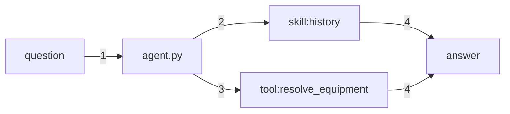

# Cite what was read

**Profile**: agent
**Lane**: research
**Approved**: 2026-11-22 - user: "go"
**Failure mode**: reads history records but does not cite them
**Target cases**: q01

## Problem

On q01, a question about a tool's history with many records, the agent reads every relevant record but cites
a third of them, so the engineer cannot check the answer before acting on it (baseline: cited_recall 0.33).

When this ships, an answer about a tool's history cites every record it used.

## Behavior

1. WHEN asked why a tool failed THEN the agent SHALL cite the id of every record it used - q01
2. WHEN asked what happened on a tool THEN the agent SHALL answer correctly within its token guardrail - q02
3. The agent SHALL keep resolving an equipment name correctly - q03

## Diagnosis

On q01 the agent reads every relevant record but cites a third of them - a synthesis failure at hop 3, not
retrieval. Cause class: behavioral (the history skill prompt).

## Shape

1. question -> `agent.py` (code) - routes history questions to the history skill, equipment ones to the tool
2. `skill:history` (surface, `prompts/history.md`) - reads the records and writes the answer; citations are lost here
3. `tool:resolve_equipment` (surface, not in the Edit Scope) - resolves an equipment name
4. out: the answer, graded on cited_recall, correctness and input_tokens

**What it disturbs**

| Surface item | Read by | Cases |
| --- | --- | --- |
| skill:history | every history question | q01, q02 |
| tool:resolve_equipment | not touched; its route must keep working | q03 |

## Hypotheses

### H1 - full-read
- Idea: tell skill:history to read every record in full before summarizing
- Why: a full read may make the agent attribute each fact to its record
- Source: diagnosis
- Expect: cited_recall up on q01
- Risk: q02 overflows its context; input_tokens above +15%

### H2 - cite-ids
- Idea: tell skill:history to cite the id of every record it used
- Why: the records were read on q01; only the citation was missing
- Source: diagnosis
- Expect: cited_recall on q01 from 0.33 to 1.0
- Risk: none expected on q02 and q03

## Cases

| Case | Question | Rubric |
| --- | --- | --- |
| q01 | Why did TOOL-123 fail PCC last week? | names the root cause and cites each record used |
| q02 | What happened on TOOL-7 yesterday? | short summary of the passdown |
| q03 | Which tool is TOOL-12? | resolves the equipment |

## Metrics

| Metric | Pass at | Guardrail | Target |
| --- | --- | --- | --- |
| cited_recall | | | +0.3 |

## Edit Scope

- prompts/history.md

## Out of scope

| Excluded | Why |
| --- | --- |
| retrieval | every relevant record is read on q01 |

## Assumptions

| Assumption | Chosen default | Rationale | Confirmed? |
| --- | --- | --- | --- |
| how a citation looks | the record id | what cited_recall matches | y |

**Open questions:** none - all resolved or logged above.

## Sources

- the baseline run on q01-q03 - binding - the Failure Mode and its numbers
