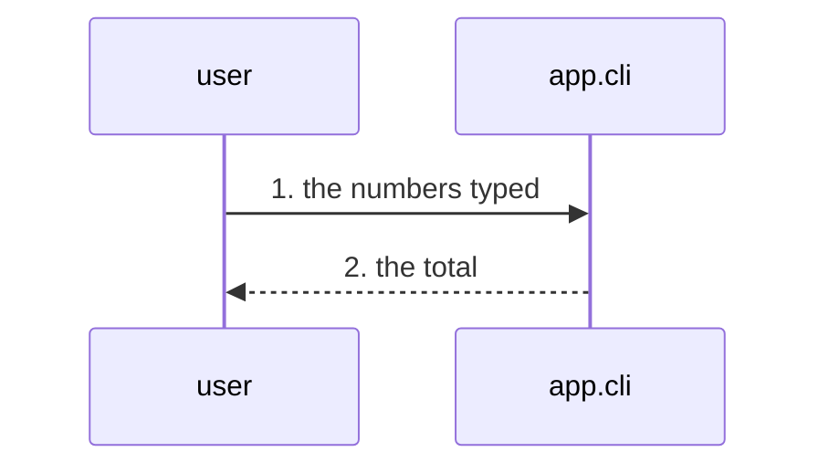

# Sum command

**Profile**: app
**Lane**: build
**Approved**: 2026-11-22 - user: "go"

## Problem

A user who needs the total of a few numbers has to open a spreadsheet or a calculator for it. The source
gives no evidence beyond the request.

When this ships, a user types numbers after the command and sees their total.

## Shape

This reuses the package's entry point instead of adding a new script. The rule that adds the numbers runs in
`app.cli.total`, which `e2e/test_cli.py` reaches by running the command as a user does.

1. in: the numbers typed after `python -m app.cli` -> `app.cli` (new) - adds them and prints the total
2. out: the total on stdout

**Changes underneath**

| Front | What changes |
| --- | --- |
| domain | nothing |
| stored data | nothing to migrate |
| readers | none |

Data: none - the command stores nothing.

## Surface

None - nothing consumed outside: a person runs `python -m app.cli <numbers>`, and the Criteria hold what it
prints.

## Landing

None - a command with no stored data and no consumer; its output is reversible in a refactor.

## Criteria

### S1: a user sums numbers (P1)

The user sees the total of what they typed.

**Acceptance Criteria**

1. WHEN a user runs the command with numbers THEN the system SHALL print their total
   - 2 3 → 5
2. WHEN a user runs the command with no numbers THEN the system SHALL print 0
   - (nothing) → 0

## Out of scope

| Excluded | Why |
| --- | --- |
| decimals | the request is about whole numbers |

## Assumptions

| Assumption | Chosen default | Rationale | Confirmed? |
| --- | --- | --- | --- |
| the total of nothing | 0 | the sum of an empty list | y |

**Open questions:** none - all resolved or logged above.

## Differences from the source

None - the product matches the source

## Sources

- the user's request - binding - the command and its output
