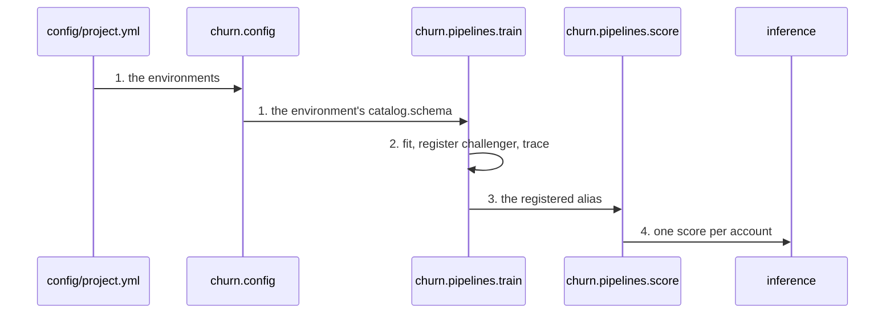
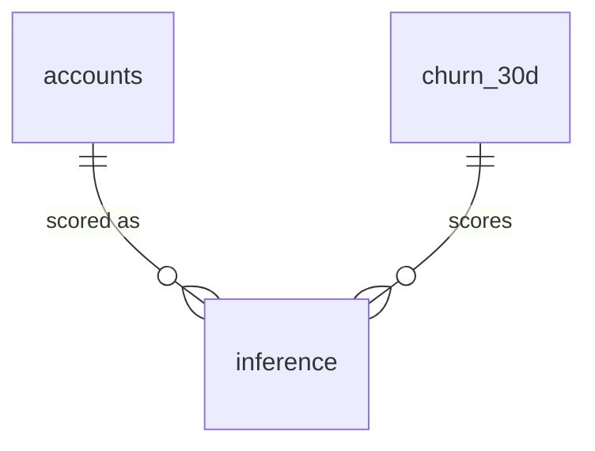

# churn - to production

**Profile**: model
**Lane**: build
**Round**: churn
**Experiment**: c0ffee0123456789
**Approved**: 2026-11-22 - user: "go, dev only for now"

## Problem

Experiment `c0ffee0123456789` of round `churn` passed its Verification (valid accuracy 0.75) but runs only in
a notebook: retention cannot act on a churn score, and nothing shows production reproduces the experiment.

When this ships, every account gets a churn score each day from a registered model whose valid metric matches
the experiment's within 0.01.

## Shape

This ports the experiment's preparation, features, model and threshold as they are, from the round's code. The
rules that change an outcome run in `churn.model`, which `tests/` reaches; each pipeline only wires config to
it.

1. in: `config/project.yml` (exists) -> `churn.config` (exists) - resolves the environment's `catalog.schema`
2. `churn.pipelines.train` (exists) - reads `main.crm.accounts`, fits `churn.model`, registers `churn_30d` as `challenger` (door 1), writes the trace
3. `churn.pipelines.score` (exists) - loads the alias and writes `inference` (door 2)
4. out: `inference`, read by retention's daily list and by the monitor

**Changes underneath**

| Front | What changes |
| --- | --- |
| domain | none - the experiment's label and threshold are kept |
| stored data | new tables in each environment's schema; nothing to migrate |
| readers | retention's daily list reads `inference` |

New: `churn_30d` registered per environment (door 1), `inference` per environment (door 2).

## Surface

None - nothing consumed outside through a route; the jobs call the pipelines with `--env`, and `inference` is
listed in `## Out of scope` until it is written on the platform.

## Landing

| One-way door | Literal shape | Alternative rejected |
| --- | --- | --- |
| registered model name | `<catalog>.<schema>.churn_30d`, alias `challenger` on training, `champion` only by promotion | one model across environments: a dev run could replace what prod serves |
| inference table | `<catalog>.<schema>.inference`: account id, timestamp, features, score, model version | scores overwritten in place: the monitor and the label join need every past score |

- Nothing else in this change is hard to reverse

## Criteria

### S1: production reproduces the experiment (P1)

Training in dev gives the experiment's valid metric, traced to its round.

**Acceptance Criteria**

1. WHEN `churn.pipelines.train --env dev` runs THEN it SHALL write `.specs/prod/trace.json` with a valid accuracy within 0.01 of 0.75 (D7)
2. The trace SHALL list every table read with its version, the commit and the hash of `uv.lock` (D8, D9)
3. The config SHALL give `dev`, `qa` and `prod` each its own `catalog.schema`, and `src/` SHALL name none of them (D1, D2)
4. WHEN a job runs THEN it SHALL call its pipeline with `--env` (D5)
5. WHEN `churn.model` scores an account THEN it SHALL give the experiment's score
   - tenure 2, 5 support calls → 1.0; tenure 30, no calls → not flagged at 0.5

## Proof

`validate_prod.py churn-mlops` (D1-D10), then `promote.py gate churn-mlops`.

## Out of scope

| Excluded | Why |
| --- | --- |
| online serving | retention reads a daily list |
| the inference table's data contract | offline, score prints its predictions instead of writing the table |
| retraining on a schedule | a new round decides when the model changes |

## Assumptions

| Assumption | Chosen default | Rationale | Confirmed? |
| --- | --- | --- | --- |
| first environment | dev only until the user says otherwise | a deploy to qa or prod needs the user's OK | n |

**Open questions:** none - all resolved or logged above.

## Differences from the source

None - the product matches the source

## Sources

- `.specs/features/churn/` (plan.md, report.md, verification.md) - binding - the round and its best experiment
- [standard.md](standard.md) - binding - D1-D10

## Promotion

**Champion**: version 1
**Challenger**: version 2
**Period**: 2026-10-01..2026-10-31
**Metric**: accuracy
**Min gain**: 0.05
**Tolerance**: 0

| Slice | Description | Target |
| --- | --- | --- |
| all | every account scored in October | yes |
| new | tenure under 6 months | |
| long | tenure of 6 months or more | |
