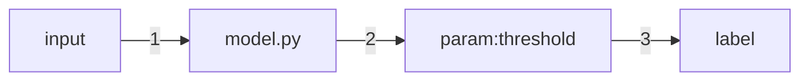

# Short-input slice

**Profile**: model
**Lane**: research
**Approved**: 2026-11-22 - user: "go"
**Failure mode**: short inputs misclassified at the global threshold
**Target cases**: short
**k**: target 3, affected 3, stable 1

## Problem

Short inputs are misclassified more often than long ones at the global threshold of 0.5: their labels flip
at a lower score, so a share of the short tickets lands in the wrong class.

When this ships, short inputs are classified as well as long ones.

## Behavior

1. WHEN the input has under 20 tokens THEN the model SHALL reach the accuracy bar of LAB.md (0.92) - short
2. The model SHALL keep the accuracy bar on inputs of 20 tokens or more - long (regression)
3. The model SHALL keep the accuracy bar on rare classes - rare

## Diagnosis

The short slice's labels flip at a lower score than the global threshold assumes. Cause class: behavioral
(a parameter, `threshold` in `model/config.json`).

## Shape

1. in: an input -> `model.py` (code) - a score in [0, 1]
2. `param:threshold` (surface, `model/config.json`) - turns the score into the label; short inputs are cut here
3. out: the label, graded on accuracy per slice, k seeds each

**What it disturbs**

| Surface item | Read by | Cases |
| --- | --- | --- |
| param:threshold | every slice | short, long, rare |

## Hypotheses

### H1 - t045
- Idea: lower param:threshold from 0.5 to 0.45
- Why: the short slice's labels flip near 0.40, the long slice's near 0.47
- Source: diagnosis
- Expect: accuracy up on short
- Risk: long, a regression Case, could drop below the bar

## Cases

| Case | Question | Rubric | Tier |
| --- | --- | --- | --- |
| short | inputs under 20 tokens | accuracy at the bar | capability |
| long | inputs of 20 tokens or more | accuracy at the bar | regression |
| rare | rare classes | accuracy at the bar | capability |

## Metrics

| Metric | Pass at | Guardrail | Target |
| --- | --- | --- | --- |
| accuracy | | | +0.03 |

## Edit Scope

- model/config.json

## Out of scope

| Excluded | Why |
| --- | --- |
| a threshold per slice | one parameter is enough to try first |

## Assumptions

| Assumption | Chosen default | Rationale | Confirmed? |
| --- | --- | --- | --- |
| where short ends | under 20 tokens | the slice the error analysis used | y |

**Open questions:** none - all resolved or logged above.

## Sources

- the per-slice baseline - binding - the slices and their accuracy
