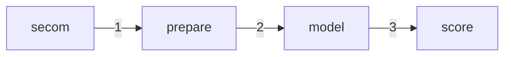

# Round secom - final test failure from the sensors

**Profile**: model
**Lane**: research
**Data kind**: tabular
**Approved**: 2026-11-20 - user: "approved, 10 iterations"

## Question
Do the sensor signals predict a lot's failure before the final test, with PR-AUC above the baseline in future periods?

## Target
- Definition: `.specs/LAB.md` (## Problem)

## Lessons loaded
none (no lesson applies)

## Data
- Table: `workspace.curated.secom`
- Lock: `.specs/split.lock`

## Metric
- Primary: pr_auc
- Min gain: 0.01
- Period: week

## Budget
- Iterations: 10

## Max drop
- Valid to OOT: 0.30

## Shape
1. in: `workspace.curated.secom` - one row per lot at the final test, its sensor readings and the label
2. `experiments/<id>.py` prepare - drops the sensors on the baseline's DROP list, imputes the rest
3. `experiments/<id>.py` model - a classifier on the kept sensors, threshold chosen on valid
4. out: a failure score per lot, judged on valid by week; the OOT weeks only in the Verification

## Backlog

### H1 - Nothing changes (noise control)
- Idea: run the baseline with one more comment
- Why: measures the evaluator's noise; the gain must be zero
- Source: domain
- Expect: a delta of zero, with a CI around it
- Risk: none

### H2 - Use sensor s000
- Idea: take s000 out of the baseline's DROP list
- Why: the EDA showed a univariate AUC of 0.82 on s000, the highest of the sensors
- Source: eda
- Expect: PR-AUC up by more than the Min gain
- Risk: s000 read after the final test would be leakage; the leakage checks run

## Out of scope

| Excluded | Why |
| --- | --- |
| image data of the lots | the round asks about the sensor signals |

## Assumptions

| Assumption | Chosen default | Rationale | Confirmed? |
| --- | --- | --- | --- |
| reporting period | week | lots are reviewed weekly | y |

**Open questions:** none - all resolved or logged above.

## Sources

- `.specs/LAB.md` (## Problem) - binding - the target and the metric
- the EDA on train - the univariate AUC of s000 behind H2
