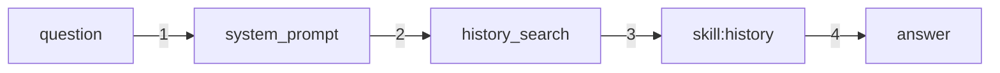
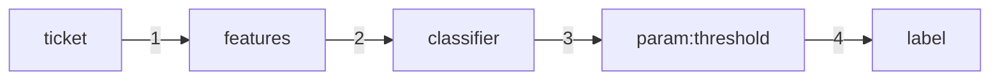

# Plan: research

The one artifact a human reads to understand an Experiment and object to it, before any variant runs, and
the one the agent works from: what is wrong, how the agent or model gets there, what each variant tries and
what it may disturb. It is agent-spec-lean's plan adapted to a proof that is a rate over a dataset. Two
halves: what must be true (the behavior and how it is measured), then what is being tried (the diagnosis,
the path, the hypotheses, the scope). They share a file because deciding the Cases in the same pass as the
hypotheses is what keeps the Cases from ratifying the hypothesis.

Write it to `.specs/features/<slug>/plan.md`. The template for an agent and the one for a model in
production are at the end. `experiment.py freeze` refuses a plan with no Problem, Diagnosis or Hypotheses.

## Before asking anything

- Read `.specs/LAB.md`: the eval command, the metrics and their bars, the Surface map, the default Edit
  Scope, the domain skills to load at **plan**.
- Read `.specs/STATE.md` `## Decisions` and the confirmed lessons when the project keeps a store
  (`agent-spec-lean/scripts/lessons.py --root <project> list --status confirmed`).
- Open every source in full: the PRD, design doc, ticket or conversation, and the dataset.
- **Read the failing outputs before writing a word of the plan**: 20 to 50 traces (agent) or the per-slice
  error analysis (model). A number you counted beats an impression; the trace ids go in the plan.

Facts you look up; decisions you ask. The user's to decide: which behavior is wanted when two are
defensible, what may not regress, the trade-off between the Target and a guardrail (tokens, latency,
training time), the Edit Scope. Ask them in rounds with agent-spec-grilling, each with your recommendation;
each answer lands in the plan in the turn it arrives.

# What must be true

## Problem

Present tense, no fix inside it: what the agent or model does today, on which questions or slices, who pays
for it and what it costs. "The history prompt does not ask for citations" is a fix in disguise; "on 14 of 40
questions about a tool's history the agent reads the passdown and cites none of it, so the engineer cannot
check the answer (traces t-12, t-31, ...)" is a problem someone can disagree with. Copy the evidence the
source gives, or say it gives none.

Close with what is different for a user when this ships: the goal the Cases are held against.

## Behavior

What the agent or model must do, in EARS, one behavior per line, each naming the Cases that grade it. This is
the research lane's Criteria: a rubric can grade every line, and every line lands on at least one Case.

| Pattern | Template |
| --- | --- |
| Event-driven | WHEN [question or input] THEN the agent SHALL [observable answer] - [cases] |
| Unwanted-behaviour | IF [condition] THEN the agent SHALL [response] - [cases] |
| Ubiquitous | The agent SHALL [invariant that must keep holding] - [cases, regression] |

```
1. WHEN asked why a tool failed THEN the agent SHALL cite the id of every record it used - q01
2. IF the question names no tool THEN the agent SHALL ask which tool and call no tool - q12
3. The agent SHALL keep resolving an equipment name in one tool call - q03 (regression)
```

For a model the subject is a slice: `WHEN the input has under 20 tokens THEN the model SHALL reach accuracy
0.92 - short`. Concrete values, never "better" or "properly". A behavior that must keep holding while the
Target moves is a regression Case: write it, it is what the variant may break.

## Cases

Where they come from, in this order: the failing traces themselves (the Target), the questions that share a
Surface item with them (the affected ones), then questions from other routes (the stable ones). A Case
written from scratch is the last resort and says so in Sources.

- **Question** and **Rubric** always. A rubric names what must appear in the answer, never "a good answer".
- **Read** and **Cite** (record ids) when the question is about retrieval; **Route**, **Failure mode** and
  **Tier** only when that is graded (AD-026).
- **Tier**: `regression` passes on every run, `capability` on the majority (AD-027).
- Every Case serves a Behavior line, and every Behavior line has a Case. A Case with no behavior grades
  nothing the user asked; a behavior with no Case is unproven.

## Metrics

One metric carries the Target delta. The pass bars come from the Baseline numbers: propose them after the
baseline runs, not before. Guardrails bound what the variant may spend: `input_tokens` +15% and
`latency_ms` +20% unless LAB.md or the user says otherwise. Rows here override LAB.md.

# What is being tried

## Diagnosis

How many outputs were read and which, the Failure Mode named in one line, its **cause class** and the
evidence: counts and trace ids, and the hop of the Shape where it goes wrong. Deterministic (fixable in code,
the same on every run) is not an Experiment: tell agent-spec-router, it goes to the build lane. Behavioral
(only the Behavioral Surface, or a model parameter, can move it) stays here.

## Shape - the path the Cases take

**The path.** One numbered line per hop from the question (or the input row) to the answer (or the score):
which prompt, skill, tool or retrieval step it crosses, what it hands on. Name each Surface item from
LAB.md's `## Surface`, marked `(surface)`, or a code module marked `(code)`: the code is not editable in this
lane. Mark the hop where the Diagnosis says it goes wrong. For a model: the source, the features, the model,
the threshold or calibration, the output, each with the config key it reads.

**The drawing.** A mermaid `flowchart` of the same hops, numbered like the list.

**What it disturbs.** A table of each Surface item the Edit Scope touches, who else reads it (other
routes, other skills, every Case when it affects all) and the Cases that come from there. That is where the
affected and stable Cases come from, and the reason the guardrails exist.

## Hypotheses

One `### H<n> - <variant>` per variant, named as `experiment.py select --variant` will name it. Each changes
**one thing** on **one Surface item**, inside the Edit Scope.

- **Idea**: the one change, and on which Surface item
- **Why**: the evidence from the Diagnosis that says it should move the Target
- **Source**: `diagnosis`, a trace id, `lesson L-NNN`, the PRD, the design doc
- **Expect**: which Cases move, on which metric, by roughly how much
- **Risk**: which Cases or guardrail it could break, and why

Order them by expected value; the variant cap (`**Variants**:`, default 3) is how many run.

## Edit Scope

The paths a variant may change, usually narrower than LAB.md's default. Every path is a Surface item the
Shape names. The gate enforces it with a git diff: a change outside it fails.

## Out of scope, Assumptions, Open questions

As in agent-spec-lean's plan: a capability that surfaced goes in Out of scope with its reason; a default you
chose goes in Assumptions with `Confirmed? n` until a human says so; every open question is marked
`blocks`, `blocks go-live` or `open`, or the line says `none`.

## Sources

Each source on one line: the PRD, design doc or ticket (binding when the user brought it as the
requirement), the trace set or error analysis, the dataset, and what each one settles.

# Before presenting

Run `experiment.py freeze <slug>` only once approved; before that, read the plan against itself:

- Every sentence of the source lands on a Behavior line, an Out of scope row or an open question.
- Every Behavior line names a Case; every Case serves a Behavior.
- Every hypothesis changes one Surface item that the Shape names and the Edit Scope allows.
- Every Surface item in What it disturbs has a Case reading it, or a guardrail that would catch it.

## Template: agent

`````markdown
# Cite what was read

**Profile**: agent
**Lane**: research
**Approved**: <only in the user's words: YYYY-MM-DD - user: "...">
**Failure mode**: reads history records but does not cite them
**Target cases**: q07
**Dataset**: <where the Cases live when not in the table below, e.g. an MLflow eval dataset>
**Budget**: 1500000
**Variants**: 3
**k**: target 3, affected 1, stable 1

## Problem

On 14 of the 40 questions about a tool's history the agent reads the passdown and cites none of it, so the
engineer cannot check the answer before acting on it (traces t-12, t-31, t-40; error analysis of 2026-11-20).

When this ships, an answer about a tool's history cites every record it used.

## Behavior

1. WHEN asked why a tool failed THEN the agent SHALL cite the id of every record it used - q07
2. WHEN asked for a short summary THEN the agent SHALL stay under its token guardrail - q02
3. The agent SHALL keep resolving an equipment name in one tool call - q03 (regression)

## Diagnosis

Read 40 traces of history questions. On 14 the agent read the right records (read_recall 1.0) and cited a
third of them or none: a synthesis failure at hop 3, not retrieval. Cause class: behavioral - the history
skill never asks for citations.

## Shape

1. question -> `system_prompt` (surface) - routes history questions to the history skill
2. `history_search` (code) - returns the records of the tool, with their ids
3. `skill:history` (surface) - reads the records and writes the answer; the citations are lost here
4. out: the answer, graded on cited_recall against the Cite column



**What it disturbs**

| Surface item | Read by | Cases |
| --- | --- | --- |
| skill:history | every history question | q07, q02 |
| tool:resolve_equipment | not touched; its route must keep working | q03 |

## Hypotheses

### H1 - cite-ids
- Idea: tell skill:history to cite the id of every record it used
- Why: the records were read on all 14 failing traces; only the citation was missing
- Source: diagnosis
- Expect: cited_recall on q07 from 0.33 to 1.0
- Risk: longer answers; input_tokens stays inside +15%

### H2 - full-read
- Idea: tell skill:history to read every record in full before answering
- Why: a full read may make the agent attribute each fact to its record
- Source: diagnosis
- Expect: cited_recall up on q07
- Risk: q02 overflows its context; input_tokens above +15%

## Cases

| Case | Question | Rubric | Read | Cite | Tier |
| --- | --- | --- | --- | --- | --- |
| q07 | Why did TOOL-123 fail PCC last week? | names the root cause; cites the passdown | WO-881, PD-12 | PD-12 | capability |
| q02 | What happened on TOOL-7 yesterday? | a summary of the passdown in under 5 lines | PD-40 | | capability |
| q03 | Which tool is TOOL-12? | resolves the equipment | | | regression |

## Metrics

| Metric | Pass at | Guardrail | Target |
| --- | --- | --- | --- |
| cited_recall | 1 | | +0.3 |
| input_tokens | | +15% | |

## Edit Scope

- src/agent/skills/history.md

## Out of scope

| Excluded | Why |
| --- | --- |
| retrieval ranking | the records were read on every failing trace |

## Assumptions

| Assumption | Chosen default | Rationale | Confirmed? |
| --- | --- | --- | --- |
| how a citation looks | the record id in brackets, e.g. [PD-12] | what the rubric can match | n |

**Open questions:** none - all resolved or logged above.

## Sources

- error analysis of 2026-11-20, 40 traces - binding - the Failure Mode and its counts
- the eval dataset `history_v3` - binding - q07, q02, q03
`````

## Template: model

A Case is a slice of the frozen holdout and k is the number of seeds. The Shape is the scoring path; the
hygiene the **work** load point brings (a domain skill such as `ml-mlflow-log`): the holdout stays frozen,
no row of it reaches training, seeds are fixed, one change per variant.

`````markdown
# Short-input slice

**Profile**: model
**Lane**: research
**Approved**: <only in the user's words: YYYY-MM-DD - user: "...">
**Failure mode**: short inputs misclassified at the global threshold
**Target cases**: short
**k**: target 3, affected 3, stable 1

## Problem

Inputs under 20 tokens are 18% of traffic and the model gets 0.81 of them right against 0.94 on the rest,
so a fifth of the short tickets go to the wrong queue (per-slice error analysis of 2026-11-19).

When this ships, short inputs are classified as well as long ones.

## Behavior

1. WHEN the input has under 20 tokens THEN the model SHALL reach accuracy 0.92 - short
2. The model SHALL keep accuracy 0.92 on inputs of 20 tokens or more - long (regression)

## Diagnosis

On the short slice the labels flip at a lower score than the global threshold assumes: 70% of its errors
score between 0.35 and 0.5. Cause class: behavioral - a parameter (`threshold` in `model/config.json`).

## Shape

1. in: a ticket's text -> `features` (code) - token counts and embeddings
2. `classifier` (code) - a score in [0, 1]
3. `param:threshold` (surface) - turns the score into the label; short inputs are cut here
4. out: the label, graded on accuracy per slice



**What it disturbs**

| Surface item | Read by | Cases |
| --- | --- | --- |
| param:threshold | every slice | short, long |

## Hypotheses

### H1 - short-threshold
- Idea: a separate threshold for inputs under 20 tokens, read from `model/config.json`
- Why: 70% of the short slice's errors score between 0.35 and 0.5
- Source: diagnosis
- Expect: accuracy on short from 0.81 to 0.92
- Risk: none on long, which keeps the global threshold

## Cases

| Case | Question | Rubric | Tier |
| --- | --- | --- | --- |
| short | inputs under 20 tokens | accuracy at the bar | capability |
| long | inputs of 20 tokens or more | accuracy at the bar | regression |

## Metrics

| Metric | Pass at | Guardrail | Target |
| --- | --- | --- | --- |
| accuracy | 0.92 | | +0.03 |
| train_seconds | | +20% | |

## Edit Scope

- model/config.json

## Out of scope

| Excluded | Why |
| --- | --- |
| retraining | a parameter is enough to move the slice; a new model is a modeling round |

## Assumptions

| Assumption | Chosen default | Rationale | Confirmed? |
| --- | --- | --- | --- |
| where short ends | under 20 tokens | the slice the error analysis used | n |

**Open questions:** none - all resolved or logged above.

## Sources

- per-slice error analysis of 2026-11-19 - binding - the slice and its errors
`````

## Then confirm

Present the plan and stop. Name the Failure Mode, the hypotheses in order and what each may break. When the
user approves, write `**Approved**: <YYYY-MM-DD> - user: "<their words>"` under the title; one the user did
not give is never written. Commit, then `experiment.py freeze <slug>`.
