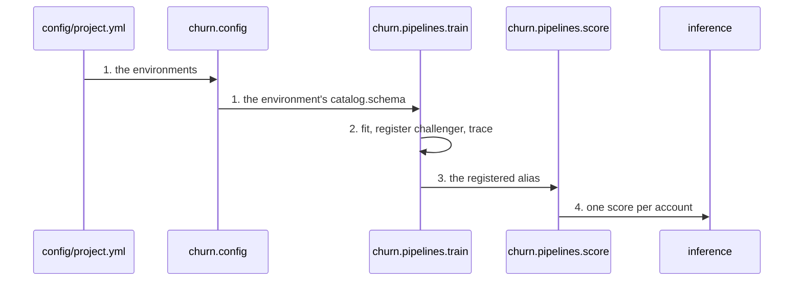
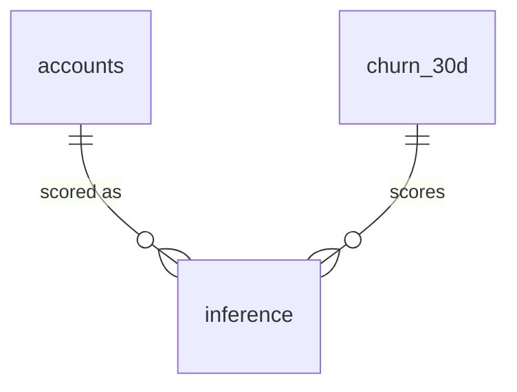

# Plan: a model to production

The research is done: a round's best experiment passed its Verification. What is left is build work, held to
the team's standard ([standard.md](standard.md)), so this plan is agent-spec-lean's plan
([plan.md](../../agent-spec-lean/references/plan.md)) with what the pipeline lane adds for the tables it
writes. Read lean's plan first: every rule about the Problem, Shape, Landing, Criteria, Assumptions and Sources
holds here.

`agent-spec-modeling`'s `deliver.py --decision promote` seeds `.specs/features/<slug>-mlops/plan.md` with the
round, the experiment, the Problem and the Proof; agent-spec-writer completes the rest with the user.
`route.py freeze` runs lean's `validate_plan.py` on it.

What each section holds for a model going to production:

- **Header**: `**Round**:` and `**Experiment**:` name what is ported, as the seed wrote them.
- **Problem**: what the business cannot do while the model lives only in a notebook, and what is different
  once it scores in production.
- **Shape**: the path from the input tables to the inference table: config, features, train, registry, score,
  monitor, each a pipeline or module of the package (`(exists)` when the repo already has it). Port the
  experiment as it is: the same preparation, features, model and threshold; any departure is a `Landing` door
  or an `Assumptions` row the user confirms. The `erDiagram` holds the input tables, the feature table, the
  registered model and the inference table.
- **Surface**: the jobs and their `--env` flag, when they are new; `None - ...` otherwise.
- **Landing**: the doors of production: the registered model's name, each table the pipelines write and who
  reads it, the environments' `catalog.schema`, a new dependency, the monitoring that will alert someone.
- **Criteria**: one per rule of the standard this work has to meet (D1-D10), in EARS, each naming the value
  that proves it: the tolerance on the valid metric, the environments, the tags, the tables. One run of
  `validate_prod.py` settles them.
- **Data contract** and **Golden rows** (from agent-spec-pipeline), when a pipeline writes a table someone
  reads, the inference table above all: compile and gate it with `contract.py` on a dev run.
- **Proof**: `validate_prod.py <slug>` (D1-D10), the tests' JUnit, then `promote.py gate <slug>`.
- **Promotion**: champion, challenger, period, metric and slices ([promote.md](promote.md)), added once the
  challenger is trained.

## Example: `.specs/features/churn-mlops/plan.md`

`````markdown
# churn - to production

**Profile**: model
**Lane**: build
**Round**: churn
**Experiment**: c0ffee0123456789
**Approved**: <only in the user's words: YYYY-MM-DD - user: "...">

## Problem

Experiment `c0ffee0123456789` of round `churn` passed its Verification (valid accuracy 0.80) but runs only in
a notebook: retention cannot act on a churn score, and nothing shows production reproduces the experiment.

When this ships, every account gets a churn score each day from a registered model whose valid metric matches
the experiment's within 0.01.

## Shape

This ports the experiment's preparation, features, model and threshold as they are, from the round's code. The
rules that change an outcome run in `churn.model`, which `tests/` reaches; each pipeline only wires config to
it.

1. in: `config/project.yml` (exists) -> `churn.config` (exists) - resolves the environment's `catalog.schema`
2. `churn.pipelines.train` (exists) - reads `main.crm.accounts`, fits `churn.model`, registers `churn_30d` as `challenger` (door 1), writes the trace
3. `churn.pipelines.score` (exists) - loads the alias and writes `inference` (door 2)
4. out: `inference`, read by retention's daily list and by the monitor



**Changes underneath**

| Front | What changes |
| --- | --- |
| domain | none - the experiment's label and threshold are kept |
| stored data | new tables in each environment's schema; nothing to migrate |
| readers | retention's daily list reads `inference` |



New: `churn_30d` registered per environment (door 1), `inference` per environment (door 2).

## Surface

None - nothing consumed outside through a route; the jobs call the pipelines with `--env`, and `inference` is
held by `## Data contract`.

## Landing

| One-way door | Literal shape | Alternative rejected |
| --- | --- | --- |
| registered model name | `<catalog>.<schema>.churn_30d`, alias `challenger` on training, `champion` only by promotion | one model across environments: a dev run could replace what prod serves |
| inference table | `<catalog>.<schema>.inference`: account id, timestamp, features, score, model version | scores overwritten in place: the monitor and the label join need every past score |

- Nothing else in this change is hard to reverse

## Criteria

### S1: production reproduces the experiment (P1)

Training in dev gives the experiment's valid metric, traced to its round.

**Acceptance Criteria**

1. WHEN `churn.pipelines.train --env dev` runs THEN it SHALL write `.specs/prod/trace.json` with a valid accuracy within 0.01 of 0.80 (D7)
2. The trace SHALL list every table read with its version, the commit and the hash of `uv.lock` (D8, D9)
3. The config SHALL give `dev`, `qa` and `prod` each its own `catalog.schema`, and `src/` SHALL name none of them (D1, D2)
4. WHEN a job runs THEN it SHALL call its pipeline with `--env` (D5)
5. WHEN `churn.model` scores an account THEN it SHALL give the experiment's score
   - tenure 2, 5 support calls → 1.0; tenure 30, no calls → not flagged at 0.5

## Data contract

### inference

**Table**: main.churn_dev.inference

| Column | Type | Required | Unique | Accepted values |
| --- | --- | --- | --- | --- |
| account_id | integer | yes | yes | |
| score | double | yes | | |
| model_version | integer | yes | | |

- rowCount between 1 and 100000

## Proof

`validate_prod.py churn-mlops` (D1-D10), then `promote.py gate churn-mlops`.

## Out of scope

| Excluded | Why |
| --- | --- |
| online serving | retention reads a daily list |
| retraining on a schedule | a new round decides when the model changes |

## Assumptions

| Assumption | Chosen default | Rationale | Confirmed? |
| --- | --- | --- | --- |
| first environment | dev only until the user says otherwise | a deploy to qa or prod needs the user's OK | n |

**Open questions:** none - all resolved or logged above.

## Differences from the source

None - the product matches the source

## Sources

- `.specs/features/churn/` (plan.md, report.md, verification.md) - binding - the round and its best experiment
- [standard.md](standard.md) - binding - D1-D10
`````

`## Promotion` is added once the challenger is trained ([promote.md](promote.md)).
