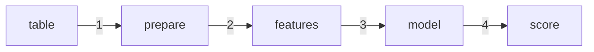

# Plan: a modeling round

The one artifact a human reads to understand a round and object to it before the climb starts, and the one
the agent and the iteration runner work from: the question, how good is judged, the data and its split, the
path a row takes to a score, every hypothesis with what it should move and what it risks. It is
agent-spec-lean's plan adapted to research. Two halves: what must be true (the question, the target, the
metric and the bar), then what is being tried (the data, the shape, the backlog, the budget).

`.specs/features/<slug>/plan.md`. `validate_plan.py <slug>` checks it (P0-P11), then
`validate_plan.py <slug> --approved` once the user approved it (A1).

## Before asking anything

- The `## Problem` of `.specs/LAB.md` is confirmed (`route.py problem` exits 0): the target, the label rule,
  the prediction time, the costs of FP and FN, the metric. The plan points at it; it never restates it.
- Read `.specs/STATE.md` `## Decisions` and the lessons that apply (`.specs/lessons.json` when the project
  keeps one); their ids go in `## Lessons loaded`.
- Open every source in full: the PRD or design doc, the previous round's `report.md` (its Next round is
  a backlog source), the EDA on train.
- The split lock exists before the EDA ([patterns/split.md](patterns/split.md)): the plan reads it, never
  moves it.

Facts you look up; decisions you ask. The user's to decide: the bar that makes the model worth it (Min gain),
how many iterations the round may spend, the largest drop from valid to OOT they accept, which ideas enter the
backlog and in what order ([ideas.md](ideas.md)). Ask in rounds with agent-spec-grilling, each with your
recommendation; each answer lands in the plan in the turn it arrives.

# What must be true

- **Question**: one full sentence - what is predicted, for whom, at what moment, and what good looks like.
- **Target**: the Problem's definition in LAB.md, by reference.
- **Metric**: the primary metric (usually the Problem's), the smallest gain worth keeping and the period the
  Verification reports the OOT by. A gain below Min gain, or whose CI touches zero, is not kept.
- **Max drop**: the largest valid-to-OOT drop allowed: above it the Verification fails, whatever the valid
  says.

# What is being tried

- **Data**: the table, the split lock, and the facts of the EDA that shape the round: rows per window, the
  positive rate, the columns dropped and why.
- **Shape**: the path a row takes to a score, one hop per step that decides something: source, the split,
  preparation, features, model, calibration or threshold, the output. Name the file or function each hop runs
  in (`experiments/<id>.*`, `src/...`), mark where each hypothesis acts, and draw it as a mermaid `flowchart`.
  Leakage lives on this path: say at which hop each feature becomes known, relative to the prediction time.
- **Backlog**: one `### H<n> - <idea>` per hypothesis, one change each:
  - **Idea**: the one change this iteration makes, and on which hop
  - **Why**: the evidence - an EDA number, an error-analysis finding, a lesson, a domain fact
  - **Source**: `eda`, `domain`, `lesson L-NNN`, `error analysis`, `recipe <name>`
  - **Expect**: what it should move on the primary metric, and on which segment
  - **Risk**: what it could break - leakage (the feature known after the prediction time), overfit to valid,
    cost
- **Budget**: the iterations the round may spend; the baseline is the first.
- **Out of scope**, **Assumptions**, **Open questions**, **Sources**: as in agent-spec-lean's plan. `none -
  <why>` is complete; a missing section is not.

## Before presenting

`validate_plan.py <slug>` checks the structure. What it cannot see stays yours: read the source again one
sentence at a time - each one lands on the Question, a hypothesis, an `Out of scope` row or an open question.
Every hypothesis acts on a hop the Shape names, and none of them reads the OOT.

## Template

`````markdown
# Round <slug> - <the question in a few words>

**Profile**: model
**Lane**: research
**Data kind**: tabular
**Approved**: <only in the user's words: YYYY-MM-DD - user: "...">

## Question
<one full sentence: what is predicted, for whom, at what moment, and what good looks like>

## Target
- Definition: `.specs/LAB.md` (## Problem)

## Lessons loaded
none

## Data
- Table: `catalog.schema.table`
- Lock: `.specs/split.lock`
- EDA: <rows per window, positive rate, columns dropped and why - from eda.md>

## Metric
- Primary: pr_auc
- Min gain: 0.01
- Period: week

## Budget
- Iterations: 10

## Max drop
- Valid to OOT: 0.30

## Shape
1. in: `catalog.schema.table` - one row per <entity> at the prediction time
2. `experiments/<id>.py` prepare - <drops, imputes>
3. `experiments/<id>.py` features - <what is built, known at the prediction time>
4. `experiments/<id>.py` model - <estimator>, threshold chosen on valid
5. out: a score per row, judged on valid; the OOT only in the Verification



## Backlog

### H1 - <the idea in a few words>
- Idea: <the one change this iteration makes, on which hop>
- Why: <why it should move the metric, with the evidence>
- Source: <eda | domain | lesson L-NNN | error analysis | recipe <name>>
- Expect: <the movement on the primary metric, and where>
- Risk: <leakage, overfit, cost - or none>

## Out of scope

| Excluded | Why |
| --- | --- |
| <capability> | <reason> |

## Assumptions

| Assumption | Chosen default | Rationale | Confirmed? |
| --- | --- | --- | --- |
| <ambiguity> | <what we will do> | <why> | y/n |

**Open questions:** none - all resolved or logged above.

## Sources

- <PRD, design doc or ticket> - binding - <what it settles>
- `.specs/features/<slug>/eda.md` - the facts the backlog stands on
`````

- **Data kind**: `tabular` or `image`.
- **Lessons loaded**: the ids of the lessons that apply from the project's lesson store when it keeps one
  (agent-spec-lean keeps `.specs/lessons.json`), or `none`.
- **Primary**: `pr_auc`, `roc_auc`, `f1`, `macro_f1`, `accuracy`, `log_loss`, `brier`, `rmse` or `mae`;
  usually the `**Metric**` of the Problem. **Period**: `day`, `week`, `month` or `quarter`, how the
  Verification reports the OOT.
- **Max drop**: the largest valid-to-OOT drop allowed, in (0, 1], in the metric's units.

## The split lock

`.specs/split.lock` is written once per project, before any EDA ([patterns/split.md](patterns/split.md)):

```json
{
  "table": "catalog.schema.table",
  "time_col": "event_ts",
  "label_col": "label",
  "windows": {"train": ["2025-01-01", "2025-12-31"], "valid": ["2026-01-01", "2026-03-31"],
              "oot": ["2026-04-01", "2026-06-30"]},
  "counts": {"train": 52000, "valid": 13000, "oot": 12500}
}
```

The windows are ordered train < valid < oot with no overlap, and every split has rows.

## Then confirm

Present the plan and stop. Name the Question, the bar, the budget and the backlog in order. When the user
approves the backlog and the budget, write `**Approved**: <YYYY-MM-DD> - user: "<their words>"`; one the
user did not give is never written. Then `validate_plan.py <slug> --approved`.
