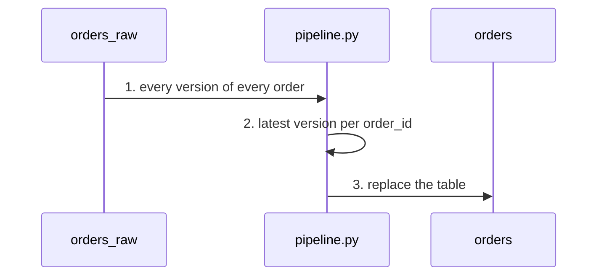
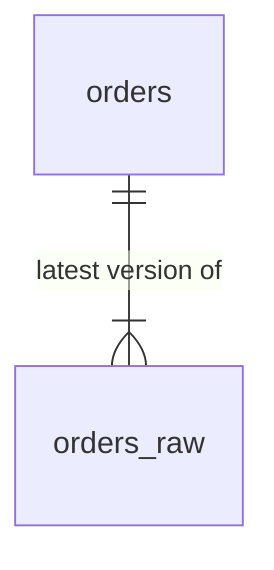

# Plan: pipeline

A pipeline's plan is agent-spec-lean's plan ([plan.md](../../agent-spec-lean/references/plan.md)): read it
first, it holds every rule about the Problem, the Shape, the Landing doors, the Criteria, Assumptions and
Sources. The pipeline adds three sections, because its proof is its output, not a screen or a route:

- **Input fixture**: the small versioned input the proof runs on, and every case it covers. Each criterion
  with an example points at rows in it.
- **Data contract**: what every output row promises, one `### <dataset>` per table, compiled to SQL by
  `contract.py compile`. Leave it out when the project keeps an ODCS file in `contracts/`.
- **Golden rows**: exact rows the fixture must produce, checked on the first dataset; values compare as text.

What the lean sections hold for a pipeline:

- **Problem**: what readers of the output get wrong today (a dashboard, an export, a model), and what is
  different for them when this ships.
- **Shape**: the path from each source table to each output, one hop per step that decides something
  (dedup, join, filter, aggregate), naming the function where that rule runs - in a layer the fixture run
  reaches. The `erDiagram` holds the sources and outputs and how their keys relate; no columns there, the
  columns live in the Data contract.
- **Surface**: a pipeline exposes tables, not routes: `None - ...` pointing at the Data contract, unless it
  also adds an API or a command.
- **Landing**: an output table someone reads is a door: its grain (one row per what), its key, how it is
  written (replace, merge, append) and its schema.
- **Criteria**: what the fixture run must show, each with the fixture rows that prove it; the strong case is
  the row that breaks a naive implementation (two versions of one order, a late update, a null key).

Write it to `.specs/features/<slug>/plan.md`. `agent-spec-lean`'s `validate_plan.py <slug>` judges its
structure (`route.py freeze` runs it), and `contract.py compile <slug>` the contract.

## Example: `.specs/features/orders/plan.md`

`````markdown
# Orders pipeline

**Profile**: pipeline
**Lane**: build
**Approved**: <only in the user's words: YYYY-MM-DD - user: "...">

## Problem

Readers of `orders` - the sales dashboard and the finance export - get one row per version of an order: an
order updated twice is counted three times and shows every status it ever had. The source gives no count.

When this ships, readers get one row per order with its latest status, refreshed daily.

## Shape

This reuses the raw extract ingestion already lands, instead of reading the source system again. The rule
that keeps the latest version runs in `pipeline.py`, which the fixture run executes end to end.

1. in: `orders_raw` (exists) - every version of every order, with its `version`
2. `pipeline.py` (new) - keeps the highest `version` per `order_id`
3. out: `orders` (door 1), replaced on each run with `loaded_at` set to the run time



**Changes underneath**

| Front | What changes |
| --- | --- |
| domain | an order meant one version of it, now means the order - the dashboard counts rows |
| stored data | nothing to migrate: the table is replaced on each run |
| readers | the sales dashboard and the finance export read one row per order |



New: `orders`, one row per `order_id` (door 1).

## Surface

None - nothing consumed outside through a route; the `orders` table readers consume is held by
`## Data contract`.

## Landing

| One-way door | Literal shape | Alternative rejected |
| --- | --- | --- |
| `orders` table, one row per order | `orders(order_id integer unique, status string, loaded_at timestamp)`, replaced on each run | a view over `orders_raw`: every reader pays the dedup, and the contract cannot be checked on a stored output |

- Nothing else in this change is hard to reverse

## Criteria

### S1: one row per order (P1)

Readers see each order once, with its latest status.

**Acceptance Criteria**

1. WHEN the pipeline runs on `fixture/orders_raw.csv` THEN `orders` SHALL hold exactly one row per `order_id`
   - order 1 with versions 1 and 2 → one row; order 3 → one row
2. WHEN an order has several versions THEN the pipeline SHALL keep the one with the highest `version`
   - order 1: open in version 1, closed in version 2 → `closed`
3. WHEN an order was cancelled THEN `orders` SHALL show it with status `cancelled`
   - order 3 → `cancelled`

## Input fixture

`fixture/orders_raw.csv` - an order with two versions (open, then closed), and a cancelled one.

## Data contract

### orders

**Table**: dev.sales.orders

| Column | Type | Required | Unique | Accepted values |
| --- | --- | --- | --- | --- |
| order_id | integer | yes | yes | |
| status | string | yes | | open, closed, cancelled |
| loaded_at | timestamp | | | |

- rowCount between 1 and 1000
- freshness loaded_at 24h
- sql no_open_without_date: SELECT COUNT(*) FROM dev.sales.orders WHERE status = 'open' AND loaded_at IS NULL

## Golden rows

| order_id | status |
| --- | --- |
| 1 | closed |
| 3 | cancelled |

## Out of scope

| Excluded | Why |
| --- | --- |
| a history of status changes | readers asked for the latest status only |

## Assumptions

| Assumption | Chosen default | Rationale | Confirmed? |
| --- | --- | --- | --- |
| which version is the latest | the highest `version` | `loaded_at` of the raw rows is the ingestion time, not the change time | n |

**Open questions:** none - all resolved or logged above.

## Differences from the source

None - the product matches the source

## Sources

- the ticket asking for one row per order - binding - the grain and the readers
`````

Contract rules: `rowCount between <a> and <b>`, `freshness <column> <hours>h`, `sql <name>: <query returning a
violation count>`.
